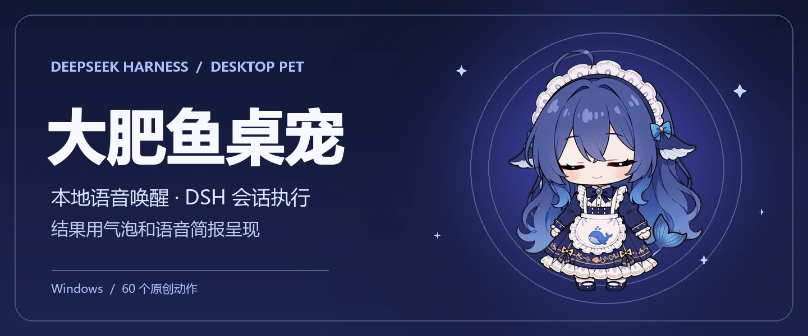
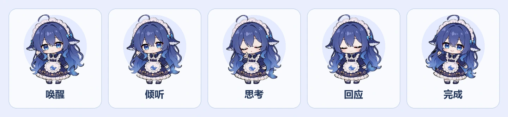
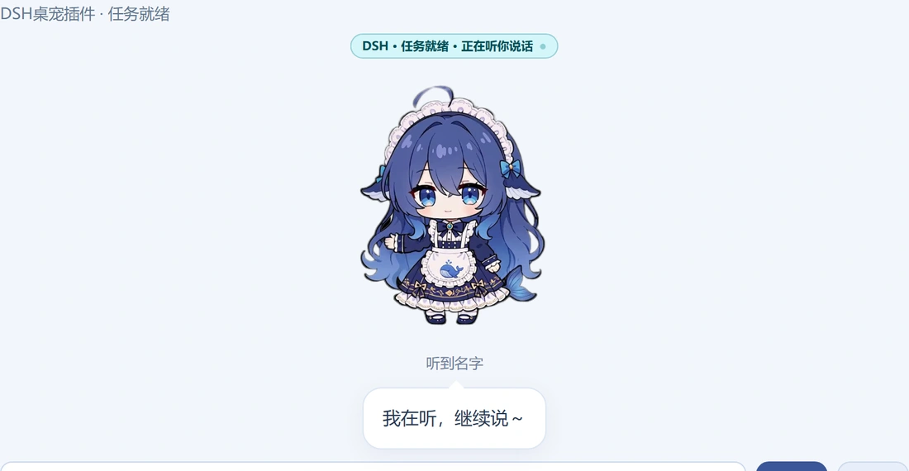
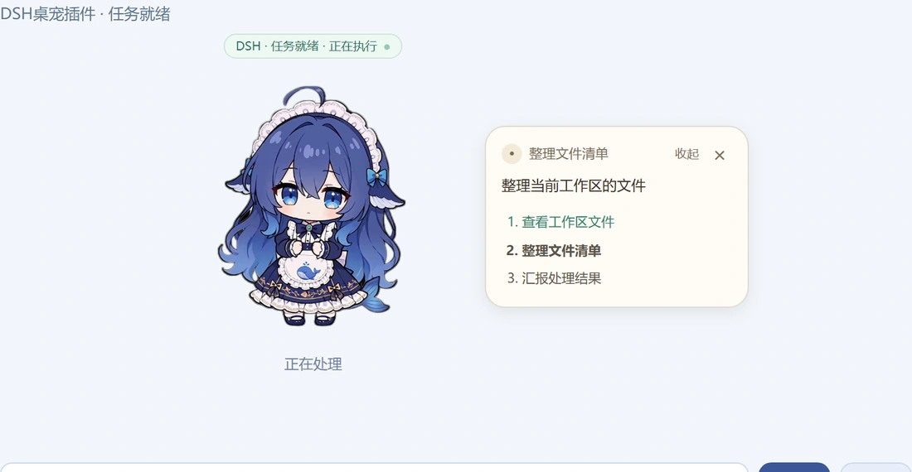
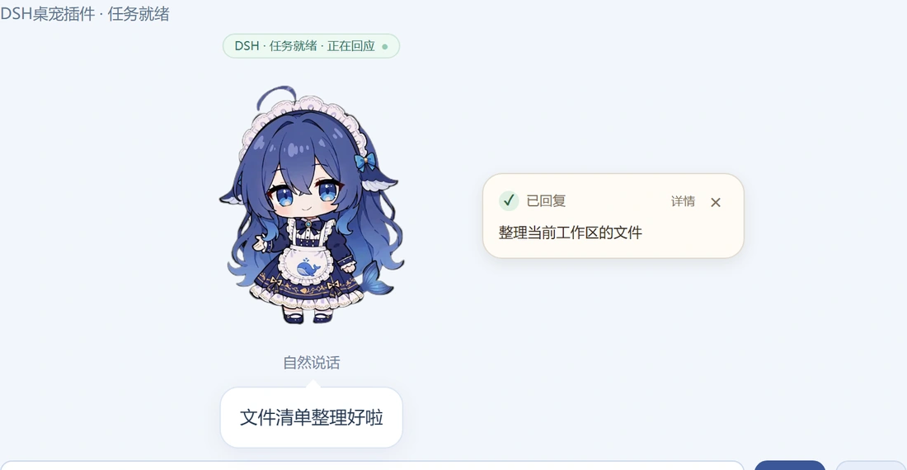

# 大肥鱼 · 原创桌宠



[下载 Windows 安装包](https://github.com/wudi3632-ctrl/dsh-pet-assistant/releases/latest) · [安装教程](INSTALL.md) · [更换角色](CHARACTERS.md)

叫一声「大肥鱼」，它会显示正在倾听，把识别到的任务交给 DSH 的「桌宠语音」会话。处理完成后，可以通过气泡查看简报，配置 Qwen TTS 后也能听到播报。

这是独立的 Windows DSH 插件，包名为 `dsh-dashifeiyu-pet`。从旧版升级时，先在 DSH 中停用原先的桌宠插件。

## 效果预览



<details>
<summary>播放回应动作</summary>


</details>

| 语音唤醒与气泡 | 可展开的任务卡 |
| --- | --- |
|  |  |



*截图来自新版界面，使用演示语音状态和任务数据。任务完整结果留在 DSH 会话里。*

## 功能

- **桌面陪伴**　60 个原创透明 WebM 动作，支持拖动、右键菜单、透明区点击穿透，以及导入其他角色的动作包。
- **本地语音输入**　Sherpa 唤醒和 ASR 启动时预热，连续对话空闲 30 秒后回到待唤醒状态。
- **DSH 会话接力**　确认客户端打开「桌宠语音」会话后再派发任务。任务卡可展开，回复后会自动收起。
- **结果简报**　同一回合生成简报，气泡随语音播放进度更新。Qwen TTS 可按需配置，也可仅使用气泡。

通用 Windows 窗口操作取决于 DSH 工具、权限和审批。当前实测通过的是文件任务，记事本与资源管理器的窗口验收仍有待解决。见[验收范围](ACCEPTANCE.md)。

## 安装

从[Releases](https://github.com/wudi3632-ctrl/dsh-pet-assistant/releases/tag/v0.3.2)下载 **0.3.2 Windows source ZIP**，解压到固定目录。已安装DSH和Node.js 22+后，在该目录运行：

```powershell
node scripts/install.mjs
```

安装器自动找运行中的DSH与已有Electron；缺运行时则通过npm准备。进入 **DSH → 插件 → dsh-dashifeiyu-pet → 启用/显示桌宠** 即可先使用角色与文字任务。不需要旧dsh-pet，也不需要作者的配置或账号。

需要语音输入时，安装Python 3.11并运行：

```powershell
py -3.11 scripts/setup-speech.py
```

脚本自动准备CPU版唤醒/ASR模型与独立Python环境，校验下载并写入本机设置。第一次需要联网，之后模型本地常驻。Qwen TTS为可选项，有完整服务示例、依赖安装与自备参考录音教程，不要求基础安装用户下载大模型。

**完整教程：[INSTALL.md](INSTALL.md)**，包括下载正确版本、安装、首次任务、麦克风、离线模型、Qwen、诊断、更新和卸载。

```powershell
npm run doctor
```

也可克隆本仓库后执行相同安装命令：`git clone https://github.com/wudi3632-ctrl/dsh-pet-assistant.git`。本版是独立实现，升级旧版前先在DSH中停用旧版插件，避免两个桌宠同时运行。

纯浏览器开发预览可运行 `npm start` 后打开 http://127.0.0.1:57832/；透明桌面运行 `npm run desktop`。DSH任务仍需已启用插件和已连接的DSH客户端。

本地配置保存在被Git忽略的settings.local.json，模型/虚拟环境在.runtime。不要将私人配置、参考录音或会话一起上传。程序与素材分发边界见[THIRD-PARTY-NOTICES.md](THIRD-PARTY-NOTICES.md)。

## 替换原创动画

1. 把WebM放入`public/assets/motions/`。
2. 编辑`public/assets/motions.json`，找到同名动作ID并设置`enabled: true`。当前交付文件名为`dfy_<id>_v002_768_24.webm`。
3. 点击“重新读取动画清单”；不需要重写动作调度代码。
4. 以透明背景、实际脚底锚点及循环接缝验收。牵引动作需填写实测`handAnchor`再接通鼠标轨迹定位；现阶段只显示牵引状态占位，不会主动移动真实光标。

当前交付为768×768、24fps、VP9 Alpha WebM、无音轨。动作清单在public/assets/motions.json。素材不可用才显示占位。

## 事件接入

`POST /api/events`支持本机工具适配器发送真实事件，需请求头`x-pet-client: 1`；前端通过`GET /api/events`接收。

```json
{"type":"task.plan","turnId":"当前回合ID","seq":3,"steps":[{"id":"open","label":"打开浏览器"}]}
```

```json
{"type":"tool.progress","turnId":"当前回合ID","seq":4,"stepId":"open","status":"completed"}
```

回合ID必须对应当前回合，seq单调增加。支持`voice.*`、`turn.*`、`tool.started`、`tool.progress`、`approval.required`、`audio.*`、`pointer.move`、`pointer.arrived`、`pointer.click`。鼠标事件只表达执行器引起的操作，不追随用户自由移动鼠标；目前还没有从所有DSH Windows工具自动提取轨迹。桌面模式收到pointer事件时临时全窗穿透，避免操作点击角色。

## 验证

```powershell
npm test
python -m unittest discover -s tests -p test_setup_speech.py
```

测试边界与结果见[ACCEPTANCE.md](ACCEPTANCE.md)。浏览器截图保存在被Git忽略的`artifacts/`。
